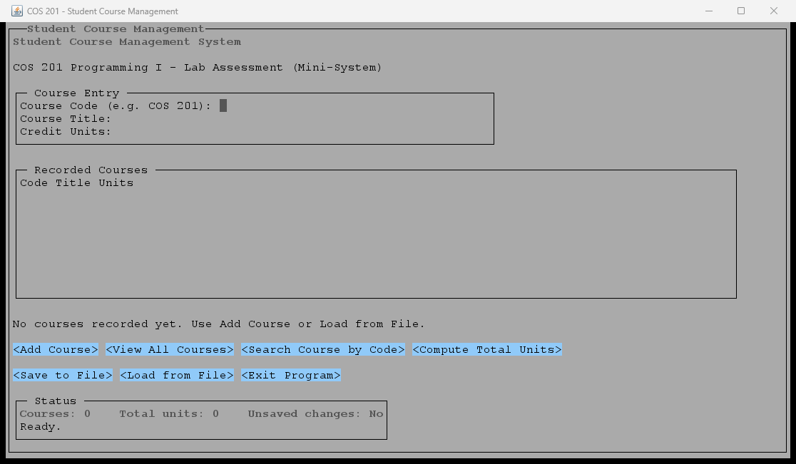

# Student Course Management (COS 201 Mini-System)

A small Java desktop application for managing a student's course list. The user
interface is a Swing dashboard styled with FlatLaf, so it can be launched
directly from IntelliJ IDEA or with the Maven Wrapper.

The project keeps the design intentionally small: one model class, one service
class, one file handler, a focused set of UI classes, and one entry point. It
does not use a database, a web server, Spring, authentication, or any other
unrelated feature.

## Features

The application provides all seven required actions:

1. Add Course
2. View All Courses
3. Search Course by Code
4. Compute Total Units
5. Save to File
6. Load from File
7. Exit Program

Additional behaviour:

- Course codes are normalized, so `cos201`, `COS 201`, and ` cos  201 ` all
  become `COS 201`.
- Duplicate course codes are rejected.
- Blank titles, invalid codes, zero/negative units, nonnumeric units, and
  integer overflow are rejected with clear status messages.
- Search is implemented recursively.
- Total units are computed with a normal loop.
- Saving writes a complete snapshot, not an append, so repeated saves do not
  create duplicate records.
- Loading validates the entire file before replacing the current list. A bad
  line reports its line number and leaves the existing list unchanged.
- Unsaved changes are tracked, and load/exit actions ask before discarding or
  replacing data.
- File operations run on a background `SwingWorker` so the window stays
  responsive.
- A selected course can be edited without changing its original reference. The
  edited course may keep its code, while changing to another existing code is
  rejected.
- Deleting a selected course requires confirmation. **Cancel** in the
  confirmation dialog leaves the record untouched.
- Edit and delete operate on the selected row even when the table is sorted or
  the search filter is active; the active search is reapplied afterward.
- Editing changes the primary form action to **Save Changes** and the clear
  action to **Cancel Edit**. No change is written to disk until **Save to
  File** is used.

## Requirements

- JDK 27. The Maven configuration uses `<maven.compiler.release>27</maven.compiler.release>`.
- A desktop environment. The application uses Swing and FlatLaf.
- No global Maven installation is required because the Maven Wrapper is included.
- The dependency `com.formdev:flatlaf:3.8` is downloaded from Maven Central on
  the first build.

## Quick Start (PowerShell)

From the project root:

```powershell
.\mvnw.cmd clean package
.\mvnw.cmd exec:java
```

The application opens a Swing dashboard with a dark navigation sidebar, summary
cards, a course entry form, a searchable table, file actions, and a status bar.
Saved records are written to `data\courses.txt` relative to the working
directory. The file is not loaded automatically at startup; use **Load from
File** after starting the program.

If you use the classic Command Prompt instead of PowerShell, run:

```bat
mvnw.cmd clean package
mvnw.cmd exec:java
```

## Run in IntelliJ IDEA

1. Open IntelliJ IDEA and choose **File > Open**.
2. Select the project folder `Student Course Management (Mini-System)` itself,
   not just the `pom.xml` file, and click **OK**.
3. If IntelliJ asks whether to trust the project, choose **Trust Project**.
4. Wait for indexing and Maven import to finish. If it does not start
   automatically, open the **Maven** tool window and click
   **Reload All Maven Projects**.
5. Set the project JDK:
   - Open **File > Project Structure > Project**.
   - Set **SDK** to JDK 27.
   - Set **Language level** to **27**.
6. Create a run configuration:
   - Open **Run > Edit Configurations**.
   - Click **+** and choose **Application**.
   - Name: `Student Course Management`
   - Main class: `com.simon.coursemanagement.Main`
   - Module: `student-course-management`
   - JRE: JDK 27
   - Working directory: the project root
     (`C:\Users\OYALE\Desktop\Project\Student Course Management (Mini-System)`)
7. Click **Apply**, then **OK**.
8. Run the configuration with **Run > Run 'Student Course Management'**.

The working directory must be the project root if you want the default
`data\courses.txt` path to resolve there. IntelliJ normally uses the project root
for a newly created Application configuration.

If IntelliJ reports that `Main` cannot be found, run the wrapper build once and
reload the Maven project:

```powershell
.\mvnw.cmd clean package
```

## Using the Application

- The **Dashboard** and **Courses** sidebar buttons move focus to the main entry
  form or the course search field.
- Use **Tab** and **Shift+Tab** to move between controls.
- Press **Enter** in the entry fields to add a course, or press **Enter** in the
  search field to search.
- Use **Up/Down** to select a row in the course table.
- The status bar at the bottom reports success, busy, and error messages.
- The summary cards show the number of courses, total credit units, and whether
  there are unsaved changes.
- **Add Course** validates the three fields, adds the record, refreshes the
  summary and table, and returns focus to the course code field.
- Select a table row and use **Edit Selected** to load it into the entry form.
  Change the fields and choose **Save Changes**, or choose **Cancel Edit** to
  leave the record unchanged.
- Select a table row and use **Delete Selected** to remove it. The confirmation
  dialog offers **Delete** and **Cancel**.
- **Clear Form** empties the entry fields without changing saved records. In
  edit mode the same button is labelled **Cancel Edit**.
- **Search** finds a course by code recursively; **Show All** restores the full
  list.
- **Compute Total Units** recalculates and reports the total.
- **Save to File** writes the current list to `data\courses.txt`.
- **Load from File** replaces the current list only after the whole file has
  been validated. A successful load clears any active selection and edit state.
- **Exit** and the window close button both check for unsaved changes.

### Sample data

A ready-made sample file is included at `data\sample-courses.txt`. To try it,
copy it over the live file:

```powershell
Copy-Item -LiteralPath "data\sample-courses.txt" -Destination "data\courses.txt" -Force
```

Then start the application and choose **Load from File**.

Do not store your only copy of the data in `data\sample-courses.txt`; that file
is intended to stay as a reusable sample. The live file `data\courses.txt` is
ignored by Git.

### Saved file format

The file is UTF-8 text with one record per line and exactly three tab-separated
fields:

```text
CODE<TAB>TITLE<TAB>UNITS
```

For example (the separators shown as `\t` here are real tab characters in the
file):

```text
COS 201\tIntroduction to Programming\t3
MTH 201\tMathematics for Computing\t4
```

Tabs and line breaks are rejected in course codes and titles so a saved record
can never be split into the wrong fields.

## Verification

The project includes a plain-Java verification program with no test-only
dependencies. It uses temporary files, so it does not touch `data\courses.txt`.

Run the checks from PowerShell:

```powershell
.\mvnw.cmd -q clean test-compile
java -cp "target\test-classes;target\classes" com.simon.coursemanagement.VerificationChecks
```

Expected output:

```text
ALL 91 CHECKS PASSED
```

The checks cover:

- Adding and listing courses
- Code normalization and case/space-insensitive search
- Duplicate prevention
- Blank, malformed, tab/line-break, zero, negative, nonnumeric, and overflow
  input rejection
- Recursive search on first, middle, and last records, plus the empty-list case
- Total-unit calculation
- Updating a course while retaining its own code
- Rejecting an update that would duplicate another course code
- Preserving the original record when an update fails
- Deleting a course and cancelling edit mode for the deleted record
- Save/reload persistence after update and delete
- UTF-8 save/load round trip
- Missing-file error reporting
- Malformed and duplicate file rows with line numbers
- Failed loads leaving existing courses unchanged
- Snapshot saving without appending
- Read-only exposure of the internal list
- Cleanup of temporary save files

Build and package verification:

```powershell
.\mvnw.cmd clean package
```

A successful run ends with `BUILD SUCCESS`.

The automated checks cover business logic and file handling. They do not replace
a manual visual check of the Swing window; launch the application and inspect
the layout, focus states, and button behaviour before submitting screenshots.

## Screenshots for Submission

A screenshot of the real running application is included at
`docs\screenshots\01-main-window.png`. It shows the dashboard with sample course
records loaded and the **Edit Selected** and **Delete Selected** controls.



1. Start the application and add a few courses, or load
   `data\sample-courses.txt`.
2. Press **Win+Shift+S** on Windows.
3. Select the application window and save the image under
   `docs\screenshots\`.
4. Suggested captures:
   - `01-main-window.png` - the complete main window with records
   - `02-search-result.png` - a successful course search
   - `03-total-units.png` - the total-units status message
   - `04-save-success.png` - the save confirmation
   - `05-load-error.png` - a malformed-file or missing-file error
5. Use screenshots of the real running application only. Do not fabricate
   results.

## Project Layout

```text
.
|-- pom.xml
|-- mvnw
|-- mvnw.cmd
|-- README.md
|-- .gitignore
|-- .mvn/
|   `-- wrapper/
|       `-- maven-wrapper.properties
|-- data/
|   `-- sample-courses.txt
|-- docs/
|   |-- COS 201 Lab Assessment.pdf
|   |-- Student_Course_Management_Project_Plan.pdf
|   |-- report-draft.md
|   `-- screenshots/
|       `-- 01-main-window.png
|-- src/
|   |-- main/java/com/simon/coursemanagement/
|   |   |-- Main.java
|   |   |-- model/Course.java
|   |   |-- service/CourseManager.java
|   |   |-- storage/CourseFileHandler.java
|   |   `-- ui/
|   |       |-- AppButton.java
|   |       |-- CourseTableModel.java
|   |       |-- MainFrame.java
|   |       `-- UiTheme.java
|   `-- test/java/com/simon/coursemanagement/
|       `-- VerificationChecks.java
`-- target/                 (generated by Maven, not committed)
```

## Design Assumptions

- The course code format is intentionally project-specific: exactly three
  letters followed by exactly three digits. This is not claimed to be a
  university-wide rule.
- Course codes are stored with a single space, for example `COS 201`.
- Records are stored in a plain UTF-8 text file, not a database.
- The application is single-user and does not attempt concurrent file access.
- Update and Delete are provided as additional management actions beyond the
  required seven. Both change only the in-memory list until **Save to File** is
  used.
- The application does not load data automatically at startup; this keeps
  startup predictable and lets the user choose when to replace the current list.

## Troubleshooting

**The window does not open**

- Make sure you are running on a desktop session, not a headless CI session.
- Check that JDK 27 is selected in IntelliJ and that the Maven import completed.

**`No saved file was found at data\courses.txt`**

- Add at least one course and use **Save to File**, or copy
  `data\sample-courses.txt` to `data\courses.txt`.

**`Could not load ... Line N`**

- Open the saved file and fix the reported line. It must contain exactly three
  tab-separated fields: code, title, and units.
- The current in-memory list is not changed by a failed load.

**The build uses the wrong Java version**

- Confirm the project SDK is JDK 27.
- The project intentionally targets Java 27 through `maven.compiler.release`.
  To use an older JDK, lower that value in `pom.xml` and use a matching JDK.

**The layout looks cramped**

- The default window is 1240 by 700 pixels with a minimum of 1000 by 700.
- At the minimum width, the search and selection buttons wrap onto two rows.
- The course table scrolls independently when more records are loaded.
- On a smaller display, maximize the window or reduce the operating-system
  display scaling.
